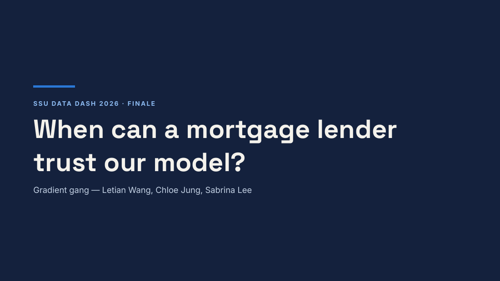
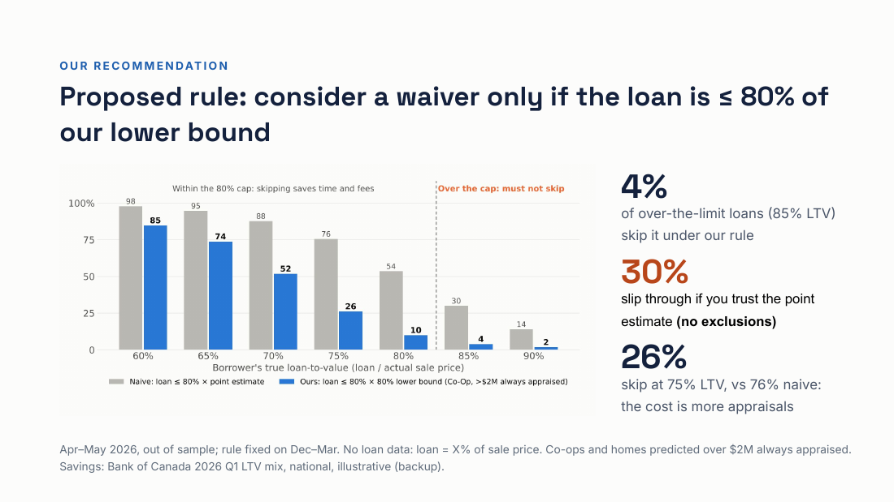

# SSU Data Dash 2026 — Toronto Home-Price Prediction

**🏆 3rd Place, Final Round ($300 prize) · 1st Place, Round 1**
University of Toronto Statistical Sciences Union (SSU) · November 2026
Team **Gradient Gang**: Sabrina Lee, Chloe Jung, Letian (Bill) Wang

## Overview

A machine-learning case competition hosted by the UofT Statistical Sciences Union. Using about **150,000 Toronto home sales (Jan 2021 – May 2026)**, teams predicted the sale prices of homes sold June – September 2026 in two tracks:

- **Off-market:** predict price without the list price.
- **List-aware:** predict price using the list price.

Our team ranked **1st in Round 1** (written report, slide deck, recorded presentation) and advanced to the finale, where we pitched to industry professionals and placed **3rd overall**.

## My role

- Interpreted the team's model results and translated them into clear, presentation-ready insights.
- Built the presentation decks, contributed to the written report, and delivered the recorded presentation.
- Presented the final-round pitch to industry professionals.

## Approach

- **Market-indexed modelling.** A two-way fixed-effects regression (month + community × type) gives a monthly market index. Models learn each home's price *relative to the market*, then add back a forecast of the market at the expected sale month (3- and 6-month trend readings blended).
- **Four feature pillars.** Property characteristics, listing-description text (phrase groups, TF-IDF ridge score, SVD topics), earlier comparable sales (10 nearest comps, same-building resales, community windows), and list price (list-aware track only).
- **Ensembles.** Off-market: HistGradientBoosting + LightGBM + CatBoost, each at two market horizons, combined by geometric mean. List-aware: tree models on log price and log(sold/list) plus a spline ridge regression.
- **Honest validation.** Walk-forward validation (Dec 2025 – May 2026), summer backtests in 2023 – 2025 that mirror the real test, locked hold-out months scored only once, and automated tests that keep future sales out of each home's features.

## Results

| Track | Our median error (MdAPE) | Starter baseline | Hidden test |
|---|---|---|---|
| Off-market | **7.1%** | 20.8% | **6.65%** |
| List-aware | **4.2%** | 7.3% (list price) | **3.86%** |

The off-market 80% prediction intervals covered 78 – 80% of homes in validation.

## Finale: when can a mortgage lender trust the model?

In the final round we reframed the model as a decision tool. Should a mortgage lender skip a human appraisal ($300 – 500 plus a site visit) for a given loan?

Our recommendations:
1. Consider an appraisal waiver only if the loan is ≤ 80% of the model's **lower** prediction bound.
2. Pause waivers for review if the monthly median bias exceeds ±5%.
3. Know the blind spots: homes over $2M, co-ops, and fast-moving markets.
4. Pilot the model alongside human appraisals before relying on it.

> *A good model isn't the goal. Knowing when to trust it is.*

## Files

| File | Description |
|---|---|
| [`finale-slides.pdf`](finale-slides.pdf) | Final-round pitch deck (lender decision framing) |
| [`round1-slides.pdf`](round1-slides.pdf) | Round 1 slide deck (methodology and validation) |
| [`round1-report.pdf`](round1-report.pdf) | Round 1 written report |

**Links:** [Recorded presentation (YouTube)](https://www.youtube.com/watch?v=25T6oJcDFt4) · [Team code repository](https://github.com/938hj/SSU-Data-Dash)

**Skills:** Python · gradient boosting (LightGBM, CatBoost) · time-series validation · data storytelling · presentation design
