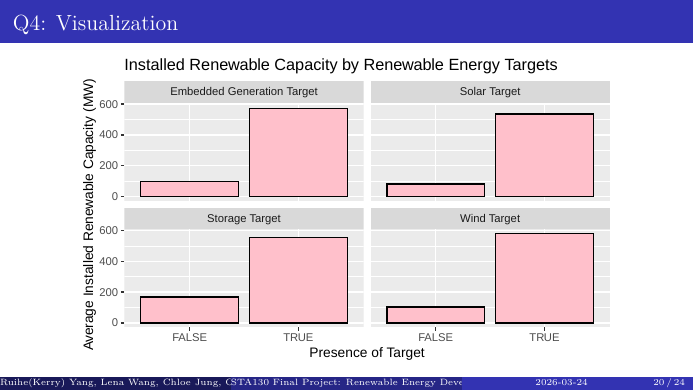

# Renewable Energy Development in African Countries

**STA130 Final Project, University of Toronto** · March 2026
Group TUT0113-C: Ruihe (Kerry) Yang, Lena Wang, Chloe Jung, Cobe Chi
Tools: **R (tidyverse, ggplot2)**

## Overview

Many African countries still struggle to provide affordable, reliable and accessible electricity. The Clean Air Task Force (CATF) is developing an Electricity Sector Performance Scorecard to help policymakers track progress. Using CATF data on **54 African countries**, our team explored how economic development, human development, electricity access and policy targets relate to renewable-energy adoption.

Each team member led one research question:

| # | Research question | Lead |
|---|---|---|
| Q1 | How does GDP per capita relate to the renewable share of electricity generation? | Lena |
| Q2 | Is HDI related to the renewable share of electricity generation? | Cobe |
| Q3 | Do countries with higher electricity access have more installed renewable capacity? | Kerry |
| **Q4** | **How do renewable-policy targets relate to installed renewable capacity?** | **Chloe (me)** |

## My question (Q4): policy targets vs. installed capacity

**Question.** How does having a renewable-energy target for wind, solar, storage or embedded generation relate to a country's total installed variable renewable capacity (MW)?

**Approach.**
- Built a **target-presence** variable (TRUE if a country's target for a technology is above 0) and a **target-type** variable (wind, solar, storage, embedded generation).
- Reshaped the data so each target type could be compared side by side.
- Visualized average installed capacity with and without each target in a faceted bar chart, and summarized the results in a table.

**Results.**

| Target type | No target (avg MW) | Has target (avg MW) | Countries (no / yes) |
|---|---|---|---|
| Wind | 103 | **581** | 7 / 47 |
| Solar | 81 | **536** | 2 / 52 |
| Storage | 168 | **555** | 5 / 49 |
| Embedded generation | 95 | **572** | 6 / 48 |

- Countries with a wind target averaged **5.6× the installed capacity** of those without (581 vs. 103 MW), the largest gap of the four target types.
- The pattern held for every target type.
- **Caveat:** very few countries have *no* target (2 – 7 per type), and the analysis is cross-sectional. It shows an association, not that targets cause more capacity.

## Team findings

- Lower-GDP countries had **higher** renewable shares (median 32% vs. 21%), so wealth alone does not drive renewable use.
- Higher-HDI countries tended to have higher renewable shares.
- Countries with higher electricity access had more installed renewable capacity (median 242 MW vs. 38 MW for low-access countries).
- Countries with renewable targets had more installed capacity, most strongly for wind.

**Conclusion:** renewable-energy development in Africa reflects a mix of economic conditions, electricity infrastructure and policy targets rather than a single factor.

## Files

| File | Description |
|---|---|
| [`sta130-final-presentation.pdf`](sta130-final-presentation.pdf) | Final presentation (24 slides) |

**Data:** Clean Air Task Force (CATF), African Electricity Sector Performance Data.
